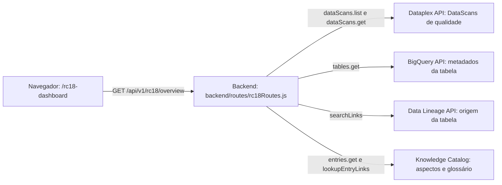

# Knowledge Catalog Business Interface + Painel RC 18

Aplicação web baseada no projeto open source
[GoogleCloudPlatform/knowledge-catalog-business-user-interface](https://github.com/GoogleCloudPlatform/knowledge-catalog-business-user-interface)
(base: v1.4.4). Ela acrescenta o painel **Qualidade RC 18** (rota `/rc18-dashboard`), que reúne evidências técnicas
para as 12 dimensões de qualidade da informação da **Resolução Conjunta nº 18, de 28 de novembro de 2025** (Banco
Central do Brasil e Conselho Monetário Nacional), art. 2º, § 2º, incisos I a XII
([texto do normativo](https://www.bcb.gov.br/estabilidadefinanceira/exibenormativo?tipo=Resolu%C3%A7%C3%A3o%20Conjunta&numero=18)).

As funcionalidades de catálogo (busca, glossários, navegação por aspectos, produtos de dados e linhagem) são as do
projeto upstream; consulte o README dele para os detalhes.

> [!NOTE]
> Este não é um produto oficialmente suportado pelo Google. *This is not an officially supported Google product.*
> Licença: [Apache 2.0](LICENSE); veja [Licença e modificações](#licença-e-modificações).

> [!IMPORTANT]
> **O painel não atesta conformidade regulatória.** A Resolução não define métricas nem níveis mínimos por
> dimensão (o Banco Central do Brasil pode estabelecê-los — art. 10, I e II). Os números são indicadores técnicos
> de apoio à política de qualidade das informações da instituição. A associação de cada indicador a uma dimensão
> é uma escolha deste projeto: valide-a com a área de conformidade antes de usá-la em relatórios.

## Sumário

- [Visão geral](#visão-geral)
- [Início rápido](#início-rápido)
- [Como os dados são carregados](#como-os-dados-são-carregados)
- [De onde vem cada informação da tela](#de-onde-vem-cada-informação-da-tela)
- [As 12 dimensões](#as-12-dimensões)
- [Preparar cada fonte no seu projeto](#preparar-cada-fonte-no-seu-projeto)
- [Identidade e permissões](#identidade-e-permissões)
- [Instalação no Cloud Run](#instalação-no-cloud-run)
- [Execução local (desenvolvimento)](#execução-local-desenvolvimento)
- [Configuração](#configuração)
- [API do painel](#api-do-painel)
- [Testes](#testes)
- [Solução de problemas](#solução-de-problemas)
- [Limites conhecidos](#limites-conhecidos)
- [Licença e modificações](#licença-e-modificações)

---

## Visão geral

O painel lê quatro serviços do Google Cloud por API, com a identidade configurada, e mostra o resultado em duas
visões no padrão visual do Knowledge Catalog Business Interface:

- **Visão geral**: faixa de não conformidades em aberto e as 12 dimensões, separadas em **Qualidade dos dados** (8)
  e **Governança no catálogo** (4).
- **Não conformidades e regras**: lista de regras com as reprovadas primeiro e visão por tabela com os sinais de
  governança.

O escopo são os **recursos com DataScan de qualidade de dados** (em geral, tabelas do BigQuery) no projeto
configurado e na localização escolhida, com filtros opcionais por dataset e por label do scan. Um recurso que não é
tabela do BigQuery entra no escopo, mas os sinais de governança dele ficam como não verificados. A Resolução trata
das informações prestadas ao Banco Central do Brasil; cabe à instituição definir o escopo regulatório, por exemplo
marcando os scans com uma label.

Três regras orientam a medição:

- **Nada é presumido.** O que não foi lido aparece como "—", "não consultado" ou "não verificada(s)", nunca como zero
  ou como conformidade.
- **Somente leitura.** O painel lê metadados, resultados de regras e aspectos do catálogo. Ele não lê os dados das
  tabelas, não executa as consultas de linhas reprovadas e não grava nada.
- **Sem texto normativo na tela.** A tela não reproduz o texto da Resolução nem cita artigos. O link **Texto do
  normativo** leva ao normativo, e a definição literal de cada dimensão fica na resposta da API e no arquivo de
  evidências.

## Início rápido

Antes de começar, tenha:

- `gcloud` autenticado com permissão de administrar o projeto;
- um OAuth Client ID do tipo *Web application* (https://console.cloud.google.com/auth/clients).

Para publicar e abrir o painel:

1. Publique o aplicativo no Cloud Run com o instalador interativo:

   ```bash
   git clone <URL-deste-repositório> painel-rc18
   cd painel-rc18
   ./deploy-gcp.sh
   ```

2. Cadastre a URL do serviço no OAuth Client, como o instalador indica ao final
   (veja [Instalação no Cloud Run](#instalação-no-cloud-run)).
3. Opcional: crie a demonstração com dados sintéticos, que preenche todas as fontes em uma tabela de exemplo:

   ```bash
   PROJECT_ID=meu-projeto ./rc18-kit/criar-demo.sh
   ```

4. Abra o serviço, entre com uma conta Google e clique em **Qualidade RC 18** na barra lateral. Escolha a localização
   e clique em **Atualizar**.

Para ver a tela sem nada configurado, clique em **Exemplo sintético**. Para preparar as tabelas reais, siga
[Preparar cada fonte no seu projeto](#preparar-cada-fonte-no-seu-projeto).

---

## Como os dados são carregados

A tela faz uma única chamada ao backend: `GET /api/v1/rc18/overview`. O backend chama as APIs do Google Cloud com a
identidade da requisição, consolida os resultados e devolve um JSON. A tela só formata e filtra o que recebe.



### Etapas da coleta

O backend executa estas etapas a cada coleta:

1. **Identidade.** Resolve uma única credencial por requisição: o token OAuth do usuário, enviado no cabeçalho
   `Authorization`, ou a conta de serviço do runtime, com `IS_SERVICE_ACCOUNT=true`. Sem token, responde 401. Só em
   desenvolvimento, com `DISABLE_AUTH=true`, usa as Application Default Credentials locais.
2. **Listagem.** Lista os DataScans de qualidade do projeto
   ([`dataScans.list`](https://docs.cloud.google.com/knowledge-catalog/docs/reference/rest/v1/projects.locations.dataScans/list),
   `filter=type="DATA_QUALITY"`), com 100 scans por página e até 20 páginas. "Todas as localizações" usa a
   localização `-`, que lista todas de uma vez.
3. **Filtros.** Calcula as opções de dataset e de label sobre todos os scans listados e só depois aplica os filtros
   escolhidos.
4. **Corte.** Ordena os scans pelo nome do recurso e mantém os 50 primeiros.
5. **Leitura detalhada.** Lê cada scan com `view=FULL`
   ([`dataScans.get`](https://docs.cloud.google.com/knowledge-catalog/docs/reference/rest/v1/projects.locations.dataScans/get)),
   seis por vez: regras configuradas, resultado do último job e data de execução.
6. **Deduplicação.** Mantém um scan por tabela, nesta ordem de preferência: scan já executado, publicação no catálogo
   habilitada (`catalogPublishingEnabled`), execução mais recente e nome do recurso. Os demais aparecem como
   duplicados ignorados.
7. **Sinais por tabela.** Lê os metadados de cada tabela no BigQuery
   ([`tables.get`](https://docs.cloud.google.com/bigquery/docs/reference/rest/v2/tables/get)). Com a localização da
   tabela, consulta a origem na Data Lineage API
   ([`searchLinks`](https://docs.cloud.google.com/knowledge-catalog/docs/reference/data-lineage/rest/v1/projects.locations/searchLinks)),
   a entrada no Knowledge Catalog
   ([`entries.get`](https://docs.cloud.google.com/knowledge-catalog/docs/reference/rest/v1/projects.locations.entryGroups.entries/get),
   `view=ALL`) e os vínculos com termos de glossário
   ([`lookupEntryLinks`](https://docs.cloud.google.com/knowledge-catalog/docs/reference/rest/v1/projects.locations/lookupEntryLinks)).
   Os metadados são lidos de seis em seis tabelas; depois, linhagem e catálogo correm em paralelo, também de seis em
   seis tabelas cada um.
8. **Consolidação.** Calcula indicadores, situações e o resumo de não conformidades em
   [`backend/rc18/dimensionReport.js`](backend/rc18/dimensionReport.js) e
   [`backend/rc18/qualityView.js`](backend/rc18/qualityView.js).

Cada chamada HTTP tem limite de 20 segundos.

### Cache e botão Atualizar

O backend guarda cada coleta por 60 segundos, separada por identidade, projeto e localização. Trocar os filtros de
dataset ou de label dentro desse tempo reaproveita a coleta. O botão **Atualizar** envia `refresh=true` e refaz a
coleta; se ela tiver menos de 15 segundos, o backend devolve a coleta guardada. Falhas de API nunca ficam guardadas:
a requisição seguinte tenta de novo.

### Falhas e leitura parcial

Uma API que falha não interrompe a coleta. A falha vai para o campo `diagnostics` da resposta, e a tela mostra o
aviso "N consulta(s) a APIs falharam" com as cinco primeiras. O que não foi lido segue estas regras:

- Indicador sem leitura aparece como "—" em cinza. Etiqueta de governança sem leitura aparece como "Nome: —", com
  contorno cinza e a dica "não consultado".
- Tabelas cuja governança não pôde ser verificada são contadas à parte ("N não verificada(s)").
- Quando a listagem falha ou é cortada, ou quando parte dos scans não é lida, nenhuma dimensão aparece como "Sem
  falhas" ou "Completo". Dimensões com parte do escopo lida passam a **Leitura parcial**. Dimensões sem nenhuma
  leitura ficam sem indicador ("Sem dados" ou "Não medido"); nas medidas por regras, a gaveta **Detalhes** informa
  que não é possível afirmar se há regras. O cabeçalho da faixa informa o motivo.
- Uma tabela sem entrada no catálogo (resposta 404) é um fato verificado: conta como sem contatos e sem termos de
  glossário, com a indicação "sem entrada no catálogo".

---

## De onde vem cada informação da tela

As tabelas a seguir ligam cada elemento da tela ao campo da API que o alimenta. Os nomes de campo seguem as APIs REST
do Dataplex (v1), da Data Lineage (v1) e do BigQuery (v2).

### Cabeçalho, filtros e ações

Elementos do topo da página:

| Elemento | Origem | Observação |
| :-- | :-- | :-- |
| Projeto (etiqueta azul) | Variável `GOOGLE_CLOUD_PROJECT_ID` | Alternativas, nesta ordem: `GOOGLE_CLOUD_PROJECT`, `GCP_PROJECT`, `PROJECT_ID` e o projeto das credenciais do runtime, detectado na inicialização; sem nenhum deles, o primeiro item de `projects` em `backend/configData.json` |
| Identidade ("Permissões do usuário conectado", "Conta de serviço do aplicativo" ou "Credenciais locais (desenvolvimento)") | Variável `IS_SERVICE_ACCOUNT`, token da requisição e, em desenvolvimento, `DISABLE_AUTH` | Veja [Identidade e permissões](#identidade-e-permissões) |
| Localização | Lista fixa da tela | "Todas as localizações" lista os scans de todas as localizações |
| Dataset | Dataset de `data.resource` dos scans listados | Opções calculadas antes do filtro e do corte |
| Label do scan | `labels` dos scans listados | Opções no formato `chave:valor`; a API aceita também só `chave` |
| Exemplo sintético | [`backend/rc18/demoData.js`](backend/rc18/demoData.js) (`demo=true`) | Dados fictícios, sempre identificados; nunca substituem dados reais |
| Atualizar | Nova coleta (`refresh=true`) | Veja [Cache e botão Atualizar](#cache-e-botão-atualizar) |
| Baixar evidências (JSON) | A resposta exibida, com `geradoEm` e `aviso` | Gerado no navegador, sem nova consulta e sem amostras de dados |
| Aviso "N consulta(s) a APIs falharam" | `diagnostics` | Fonte, recurso e mensagem das cinco primeiras falhas; o código HTTP fica em `diagnostics[].codigo`, na resposta e no JSON de evidências |

### Faixa "Não conformidades em aberto"

Cada indicador abre a lista filtrada correspondente:

| Indicador | Cálculo | Fonte |
| :-- | :-- | :-- |
| Regras reprovadas | Regras ativas reprovadas no último job do scan ativo de cada tabela, inclusive as de dimensão sem correspondência | `dataQualityResult.rules[].passed` (DataScan lido com `view=FULL`) |
| Tabelas afetadas | Tabelas com pelo menos uma regra reprovada, sobre as tabelas do escopo | Idem |
| Scans desatualizados (>30d) | Scans ativos cujo último job terminou há mais de 30 dias | `executionStatus.latestJobEndTime` |
| Lacunas de governança | Tabelas com pelo menos uma lacuna verificada: sem contato, sem origem registrada ou com coluna sem descrição | Aspecto `contacts` (Knowledge Catalog), `searchLinks` (Data Lineage) e `schema.fields[].description` (BigQuery) |

A linha acima dos indicadores vem do campo `escopo` e mostra "N tabela(s) no escopo · N scan(s) ativo(s)", seguida
destes avisos quando for o caso:

- "N scan(s) não lido(s)": falha na leitura detalhada de parte dos scans;
- "N duplicado(s) ignorado(s)": tabelas com mais de um scan;
- "lista truncada": mais de 50 scans no filtro, mais de 20 páginas na listagem ou falha depois da primeira página;
- "listagem incompleta": localizações que não responderam durante a listagem.

Quando a listagem não pôde ser lida, a linha mostra apenas "Listagem de DataScans não lida".

### Cartões das dimensões

Cada cartão mostra o nome, a situação e o indicador principal. O botão **Detalhes** abre uma gaveta com o que é
medido, a coleta, as fontes, o limite do indicador, as evidências e como medir no Google Cloud. Os textos fixos vêm de
[`backend/rc18/dimensions.js`](backend/rc18/dimensions.js); as evidências vêm da coleta. **Ver falhas** ou **Ver
regras** abre a lista de regras filtrada pela dimensão.

A situação de cada cartão segue estas regras (entre parênteses, o valor de `situacao` na API):

| Situação | Quando aparece |
| :-- | :-- |
| "N falha(s)", em vermelho (`com_falhas`) | Pelo menos uma regra ativa marcada com a dimensão foi reprovada |
| Sem falhas (`sem_falhas`) | Regras executadas, nenhuma reprovada, com o escopo lido por inteiro |
| Completo (`completo`) | Cobertura de 100%, com o escopo lido por inteiro: dimensões de governança e, sem regras executadas, o glossário de Comparabilidade |
| Com lacunas (`lacunas`) | Cobertura abaixo de 100% |
| Leitura parcial (`leitura_parcial`) | Nada falhou entre o que foi lido, mas parte do escopo (DataScans ou tabelas) não pôde ser lida |
| Informativo (`informativo`) | Relevância: o uso nos últimos 30 dias é um sinal informativo, nunca uma falha |
| Sem dados (`sem_dados`) | A dimensão tem fonte automática, mas nada foi encontrado ou lido no escopo |
| Não medido (`nao_medido`) | A dimensão não tem fonte automática, e nenhuma regra marcada com ela foi executada ou lida |

### Aba "Não conformidades e regras" → Regras

Cada linha é uma regra do scan ativo de uma tabela. As colunas vêm do DataScan lido com `view=FULL`:

| Coluna | Origem |
| :-- | :-- |
| Regra | `rule.name`, `rule.description`, o tipo da regra em português (por exemplo, "Não nulo" para `nonNullExpectation`) e o limiar `rule.threshold` ("Limiar X%"; em regras por linha, 0 ou ausente equivale a 100%) |
| Dimensão | `rule.dimension`, convertida para uma das 12 dimensões (veja [As 12 dimensões](#as-12-dimensões)) ou "Sem correspondência" |
| Tabela e coluna | Tabela de `data.resource` e `rule.column` |
| Resultado | Regra por linha: "`passedCount` de `evaluatedCount` linhas (%)"<br>Asserção SQL: "`assertionRowCount` linhas em desacordo"<br>Condição agregada: "Condição atendida" ou "Condição não atendida" |
| Situação | Aprovada ou Reprovada (`passed`); Sem execução (regra da especificação sem resultado no último job); Suspensa (`rule.suspended`) |
| Execução | `executionStatus.latestJobEndTime` do scan; "Desatualizado" acima de 30 dias |
| SQL reprovados | `failingRowsQuery`, para copiar ou expandir; o painel não executa a consulta |

A API REST omite valores zero e `false`. Por isso, `passed` ausente conta como reprovada, e `passedCount` ausente com
`evaluatedCount` presente conta como zero.

### Aba "Não conformidades e regras" → Tabelas

Cada linha é uma tabela do escopo, com o scan ativo e os sinais de governança:

| Coluna | Origem |
| :-- | :-- |
| Tabela | Tabela do scan ativo; o link abre a página da tabela no aplicativo (`/view-details`) |
| Falhas / Regras | Regras do scan ativo: reprovadas e "aprovadas / executadas (%)", com as regras sem execução e suspensas à parte |
| Dimensões com regras | Uma etiqueta por dimensão, com o percentual de regras aprovadas |
| Governança no catálogo: Contatos | Itens de `identities` com `id` ou `name` no aspecto `contacts` da entrada (`entries.get`) |
| Governança no catálogo: Descrições | Colunas com `description` em `schema.fields` (`tables.get`), incluindo campos aninhados |
| Governança no catálogo: Glossário | Vínculos do tipo `definition` com termos de glossário que referenciam a entrada da tabela, feitos na tabela ou nas colunas (`lookupEntryLinks`) |
| Governança no catálogo: Linhagem | Origens distintas (`links[].source.fullyQualifiedName`) na primeira página de `searchLinks`; o clique abre a aba Lineage |
| Última execução | `executionStatus.latestJobEndTime`; "Desatualizado (Nd)" acima de 30 dias |

As etiquetas de governança usam três estados: verde (verificado e em ordem), laranja (lacuna verificada) e contorno
cinza com "—" (não consultado). "N+" indica que a lista não foi lida inteira: o painel lê até 50 vínculos de
glossário e até 50 elos de linhagem por tabela.

---

## As 12 dimensões

A tabela mostra o indicador de cada dimensão e a fonte de onde ele é lido:

| Inciso | Dimensão | Coleta nesta versão | Indicador | Fonte |
| :-- | :-- | :-- | :-- | :-- |
| I | Acessibilidade | Parcial | % de tabelas do escopo com contatos registrados | Knowledge Catalog: `entries.get`, aspecto `contacts` |
| II | Acurácia | Automática | % de regras aprovadas (`ACCURACY` e `VALIDITY`) | Dataplex DataScans |
| III | Adaptabilidade | Regras personalizadas | % de regras aprovadas (`ADAPTABILIDADE`) | Dataplex DataScans |
| IV | Clareza | Parcial | % de colunas com descrição (evidências: tabelas com descrição e com o aspecto `overview`) | BigQuery: `tables.get`; Knowledge Catalog |
| V | Comparabilidade | Parcial | % de regras aprovadas (`COMPARABILIDADE`), quando existirem; % de tabelas do escopo com termo de glossário vinculado (indicador secundário quando há regras) | Dataplex DataScans; Knowledge Catalog: `lookupEntryLinks` |
| VI | Completude | Automática | % de regras aprovadas (`COMPLETENESS` e `VOLUME`) | Dataplex DataScans |
| VII | Confiabilidade | Regras personalizadas | % de regras aprovadas (`CONFIABILIDADE`) | Dataplex DataScans |
| VIII | Consistência | Automática | % de regras aprovadas (`CONSISTENCY` e `UNIQUENESS`) | Dataplex DataScans |
| IX | Integridade | Regras personalizadas | % de regras aprovadas (`INTEGRIDADE`) | Dataplex DataScans |
| X | Rastreabilidade | Parcial | % de tabelas do escopo com origem registrada | Data Lineage API: `searchLinks` |
| XI | Relevância | Parcial | % de tabelas do escopo com consultas nos últimos 30 dias | Knowledge Catalog: aspecto `usage` |
| XII | Tempestividade | Parcial | % de regras aprovadas (`FRESHNESS` ou `TIMELINESS`), quando existirem; data da última modificação apenas como informação | Dataplex DataScans; BigQuery |

Os tipos de coleta significam:

- **Automática**: o indicador é a razão *regras aprovadas / regras executadas* na última execução dos DataScans, o
  mesmo critério do score do Dataplex. Regras configuradas e ainda não executadas ficam fora do cálculo e são
  contadas à parte.
- **Parcial**: o indicador cobre só parte da definição da dimensão; o limite de cada um aparece em **Detalhes**.
- **Regras personalizadas**: a dimensão não tem fonte automática. O indicador vem das regras de DataScan que a
  instituição marca com a dimensão personalizada correspondente; sem essas regras, a dimensão aparece como "Não
  medido". O [kit RC 18](rc18-kit/README.md) traz regras de exemplo para cada uma.

Acessibilidade, Clareza, Rastreabilidade e Relevância formam o grupo **Governança no catálogo**; as demais formam o
grupo **Qualidade dos dados**. O valor de `rule.dimension` de cada regra define a dimensão em que ela é contada:

| Valores de `rule.dimension` | Dimensão |
| :-- | :-- |
| `ACCURACY`, `VALIDITY`, `ACURACIA` | Acurácia |
| `COMPLETENESS`, `VOLUME`, `COMPLETUDE` | Completude |
| `CONSISTENCY`, `UNIQUENESS`, `CONSISTENCIA` | Consistência |
| `FRESHNESS`, `TIMELINESS`, `TEMPESTIVIDADE` | Tempestividade |
| `ACESSIBILIDADE`, `ADAPTABILIDADE`, `CLAREZA`, `COMPARABILIDADE`, `CONFIABILIDADE`, `INTEGRIDADE`, `RASTREABILIDADE`, `RELEVANCIA` | A dimensão de mesmo nome |
| Qualquer outro valor | "Sem correspondência": a regra aparece na lista e conta em "Regras reprovadas", mas fica fora dos cartões |

Regras marcadas com uma dimensão de governança também contam: uma reprovação marca o cartão com "N falha(s)".

---

## Preparar cada fonte no seu projeto

O painel só mostra o que existe no projeto. A pasta [`rc18-kit/`](rc18-kit/README.md) executa os passos desta seção
em uma tabela de demonstração com dados sintéticos e serve de modelo.

A tabela resume o que preparar para cada informação aparecer; as subseções trazem os comandos:

| Fonte | O que preparar | Onde aparece |
| :-- | :-- | :-- |
| APIs | Dataplex, BigQuery e Data Lineage ativadas | Todas as informações |
| Dataplex DataScans | Um DataScan de qualidade por tabela do escopo, com regras marcadas por dimensão, executado | Dimensões de qualidade dos dados, faixa de não conformidades e aba Regras |
| BigQuery | Descrição das tabelas e das colunas | Clareza, etiqueta Descrições e Lacunas de governança |
| Knowledge Catalog: aspectos | Aspectos `contacts` e `overview` na entrada de cada tabela | Acessibilidade, evidência de Clareza, etiqueta Contatos e Lacunas de governança |
| Knowledge Catalog: glossário | Glossário, termos e vínculos das colunas com os termos | Comparabilidade e etiqueta Glossário |
| Data Lineage API | Tabelas geradas por jobs do BigQuery com a API ativada | Rastreabilidade, etiqueta Linhagem e Lacunas de governança |
| Knowledge Catalog: uso | Nada: o catálogo informa o uso quando disponível | Relevância |

Os exemplos usam estas variáveis:

```bash
export PROJECT_ID="seu-projeto"
export DATAPLEX_LOCATION="southamerica-east1"  # região do DataScan
export BQ_LOCATION="southamerica-east1"        # localização do dataset, em minúsculas (por exemplo, us)
export DATASET="seu_dataset"
export TABLE="sua_tabela"
export SCAN_ID="rc18-sua-tabela"               # letras minúsculas, números e hífens
```

### Ativar as APIs

O instalador `deploy-gcp.sh` já ativa estas APIs no projeto do deploy. Para outro projeto:

```bash
gcloud services enable dataplex.googleapis.com bigquery.googleapis.com datalineage.googleapis.com \
  --project="$PROJECT_ID"
```

### Regras de qualidade (Dataplex DataScans)

O painel lê o resultado do **último job** de cada scan. Para criar as regras:

1. Escreva a especificação das regras em `regras.yaml`. O campo `dimension` define a dimensão em que a regra é
   contada (veja [As 12 dimensões](#as-12-dimensões)). Dimensões personalizadas usam só letras maiúsculas, com até 30
   caracteres. As regras abaixo são ilustrativas: os testes de cada dimensão são definidos pela instituição.

   ```yaml
   catalogPublishingEnabled: true
   rules:
   - name: id-operacao-preenchido
     description: Toda posição tem o identificador da operação preenchido.
     dimension: COMPLETENESS
     column: id_operacao
     nonNullExpectation: {}
   - name: hash-de-carga-preenchido
     description: Toda linha carregada tem o hash de controle gerado na origem.
     dimension: INTEGRIDADE
     column: hash_carga
     nonNullExpectation: {}
   ```

2. Crie o DataScan. A label permite filtrar o escopo no painel pelo campo **Label do scan**:

   ```bash
   gcloud dataplex datascans create data-quality "$SCAN_ID" \
     --project="$PROJECT_ID" --location="$DATAPLEX_LOCATION" \
     --data-source-resource="//bigquery.googleapis.com/projects/${PROJECT_ID}/datasets/${DATASET}/tables/${TABLE}" \
     --data-quality-spec-file=regras.yaml \
     --on-demand=true \
     --labels=escopo=rc18
   ```

   Para executar todos os dias, troque `--on-demand=true` por `--schedule="0 6 * * *"`.

3. Execute o DataScan:

   ```bash
   gcloud dataplex datascans run "$SCAN_ID" --project="$PROJECT_ID" --location="$DATAPLEX_LOCATION"
   ```

Regras acrescentadas depois do último job aparecem como "Sem execução"; regras com `suspended: true`, como
"Suspensa". As regras podem consultar outras tabelas, como um snapshot da versão informada ou uma tabela de revisões
autorizadas. Veja os exemplos em [`rc18-kit/regras/rc18-regras-demo.yaml`](rc18-kit/regras/rc18-regras-demo.yaml) e
a documentação de [qualidade de dados automática](https://docs.cloud.google.com/knowledge-catalog/docs/use-auto-data-quality).

### Descrições de tabelas e colunas (BigQuery)

O painel conta as colunas com descrição no esquema da tabela, incluindo campos aninhados. Preencha as descrições no
console do BigQuery ou com DDL:

```sql
ALTER TABLE `seu-projeto.seu_dataset.sua_tabela`
  SET OPTIONS (description = 'Posição mensal das operações de crédito.');

ALTER TABLE `seu-projeto.seu_dataset.sua_tabela`
  ALTER COLUMN valor_saldo SET OPTIONS (description = 'Saldo devedor na data-base, em reais.');
```

`ALTER COLUMN` altera só colunas do primeiro nível. Para campos aninhados (`STRUCT`), atualize o esquema da tabela
(veja [modificar esquemas de tabela](https://docs.cloud.google.com/bigquery/docs/managing-table-schemas)).

### Contatos e documentação (aspectos do Knowledge Catalog)

O painel conta como contato cada item de `identities` com `id` ou `name` no aspecto `contacts`. Ele considera
documentada a tabela com `content` preenchido no aspecto `overview`. Para gravar os dois aspectos na entrada da
tabela:

1. Crie o arquivo `aspectos.json` (exemplo com dados fictícios):

   ```json
   {
     "dataplex-types.global.contacts": {
       "data": {
         "identities": [
           { "role": "steward", "name": "Equipe de governança de dados", "id": "governanca-dados@example.com" }
         ]
       }
     },
     "dataplex-types.global.overview": {
       "data": {
         "content": "<p>Posição mensal das operações de crédito. Acesso: procurar a equipe indicada em Contatos.</p>"
       }
     }
   }
   ```

2. Atualize a entrada da tabela no grupo `@bigquery`, na localização do dataset:

   ```bash
   gcloud dataplex entries update \
     "bigquery.googleapis.com/projects/${PROJECT_ID}/datasets/${DATASET}/tables/${TABLE}" \
     --entry-group=@bigquery --project="$PROJECT_ID" --location="$BQ_LOCATION" \
     --update-aspects=aspectos.json
   ```

A entrada de uma tabela nova pode levar alguns minutos para aparecer no catálogo. Referência:
[enriquecer entradas com aspectos](https://docs.cloud.google.com/knowledge-catalog/docs/enrich-entries-metadata).

### Glossário de negócios e vínculos com as colunas

O painel conta, por tabela, os vínculos do tipo `definition` com termos de glossário, feitos na tabela ou nas
colunas. Para vincular uma coluna a um termo:

1. Crie o glossário e os termos:

   ```bash
   export GLOSSARY_LOCATION="global"
   gcloud dataplex glossaries create glossario-negocios \
     --project="$PROJECT_ID" --location="$GLOSSARY_LOCATION" --display-name="Glossário de negócios"

   gcloud dataplex glossaries terms create saldo-devedor --glossary=glossario-negocios \
     --project="$PROJECT_ID" --location="$GLOSSARY_LOCATION" \
     --parent="projects/${PROJECT_ID}/locations/${GLOSSARY_LOCATION}/glossaries/glossario-negocios" \
     --display-name="Saldo devedor" --description="Valor devido pelo cliente na data-base."
   ```

2. Vincule a coluna ao termo pela API REST
   ([`entryLinks.create`](https://docs.cloud.google.com/knowledge-catalog/docs/reference/rest/v1/projects.locations.entryGroups.entryLinks/create)).
   A entrada do termo usa o **número** do projeto:

   ```bash
   PROJECT_NUMBER="$(gcloud projects describe "$PROJECT_ID" --format='value(projectNumber)')"
   TABLE_ENTRY="projects/${PROJECT_ID}/locations/${BQ_LOCATION}/entryGroups/@bigquery/entries/bigquery.googleapis.com/projects/${PROJECT_ID}/datasets/${DATASET}/tables/${TABLE}"
   TERM_ENTRY="projects/${PROJECT_NUMBER}/locations/${GLOSSARY_LOCATION}/entryGroups/@dataplex/entries/projects/${PROJECT_NUMBER}/locations/${GLOSSARY_LOCATION}/glossaries/glossario-negocios/terms/saldo-devedor"

   cat > vinculo.json <<EOF
   {
     "entryLinkType": "projects/dataplex-types/locations/global/entryLinkTypes/definition",
     "entryReferences": [
       {"name": "${TABLE_ENTRY}", "path": "Schema.valor_saldo", "type": "SOURCE"},
       {"name": "${TERM_ENTRY}", "type": "TARGET"}
     ]
   }
   EOF

   curl -X POST \
     -H "Authorization: Bearer $(gcloud auth print-access-token)" \
     -H "x-goog-user-project: ${PROJECT_ID}" \
     -H "Content-Type: application/json" \
     --data-binary @vinculo.json \
     "https://dataplex.googleapis.com/v1/projects/${PROJECT_ID}/locations/${BQ_LOCATION}/entryGroups/@bigquery/entryLinks?entryLinkId=valor-saldo-saldo-devedor"
   ```

Referência: [gerenciar glossários](https://docs.cloud.google.com/knowledge-catalog/docs/manage-glossaries).

### Linhagem (Data Lineage API)

Com a Data Lineage API ativada, os jobs do BigQuery que criam uma tabela a partir de outras registram a origem
automaticamente, como o `CREATE TABLE ... AS SELECT` do kit. Na validação do kit, a origem apareceu entre 16 e 25
minutos depois da criação da tabela. O painel procura os elos na localização da tabela, depois nas localizações dos
scans e por fim em `us`. Sem os metadados do BigQuery, a localização é desconhecida e a origem aparece como "não
consultada". Referência: [sobre a linhagem de dados](https://docs.cloud.google.com/knowledge-catalog/docs/about-data-lineage).

### Uso nos últimos 30 dias (Relevância)

Não há nada a configurar. O painel lê a métrica `total_queries` no intervalo `30d` do aspecto `usage` da entrada,
quando o catálogo a informa. Sem a métrica, a tabela conta como "sem métrica de uso informada", nunca como lacuna.

### Kit de demonstração

O kit cria, com dados sintéticos, datasets de exemplo, um DataScan com 19 regras marcadas com as dimensões, os
aspectos `contacts` e `overview`, um glossário e os vínculos das colunas. Ele só cria e atualiza recursos e pode ser
executado de novo:

```bash
PROJECT_ID=meu-projeto ./rc18-kit/criar-demo.sh    # cria a demonstração
PROJECT_ID=meu-projeto ./rc18-kit/remover-demo.sh  # apaga a demonstração, após confirmação
```

Pré-requisitos, resultado esperado e o que foi verificado: [rc18-kit/README.md](rc18-kit/README.md).

---

## Identidade e permissões

O painel chama as APIs com uma de duas identidades:

| Modo | Quem chama as APIs | Quem vê o quê |
| :-- | :-- | :-- |
| OAuth do usuário (`IS_SERVICE_ACCOUNT=false`, padrão) | O token do usuário conectado | Cada pessoa vê o que o próprio IAM permite |
| Conta de serviço (`IS_SERVICE_ACCOUNT=true`) | A conta de serviço do Cloud Run | **Todos** os usuários do aplicativo veem o que a conta de serviço vê |

Cuidados com cada modo:

- No modo conta de serviço, restrinja quem pode usar o aplicativo com `ALLOWED_EMAIL_DOMAINS` (o instalador exige).
- Defina `GOOGLE_OAUTH_CLIENT_ID` no backend para que só sejam aceitos tokens emitidos para o OAuth Client do
  aplicativo (o instalador define).
- No modo OAuth do usuário, as chamadas contam para o projeto do OAuth Client: crie o OAuth Client no mesmo projeto
  do deploy ou habilite as APIs também no projeto dele.
- Perfis de dados nas entradas do catálogo (`data-profile`) podem trazer estatísticas de coluna, caso estejam
  gravados no Knowledge Catalog. Leve isso em conta ao escolher o modo conta de serviço.

O instalador concede estes papéis à conta de serviço no modo conta de serviço. No modo OAuth do usuário, cada usuário
precisa de acesso equivalente:

| Papel | Chamadas | Informações na tela |
| :-- | :-- | :-- |
| `roles/dataplex.dataScanDataViewer` | `dataScans.list` e `dataScans.get` com `view=FULL` | Dimensões de qualidade dos dados, faixa de não conformidades e aba Regras |
| `roles/bigquery.metadataViewer` | `tables.get` | Clareza e etiqueta Descrições; a localização obtida aqui habilita linhagem e catálogo |
| `roles/datalineage.viewer` | `searchLinks` | Rastreabilidade e etiqueta Linhagem |
| `roles/dataplex.catalogViewer` | `entries.get` e `lookupEntryLinks` | Acessibilidade, Relevância, glossário de Comparabilidade e etiquetas Contatos e Glossário |
| `roles/dataplex.viewer` | Recursos do Dataplex | Produtos de dados (telas do upstream) |
| `roles/browser` | Leitura do projeto | Telas do upstream |

O painel RC 18 não consulta os dados das tabelas. A leitura de **dados** das tabelas (amostras do catálogo upstream)
exige `roles/bigquery.dataViewer` e `roles/bigquery.jobUser`, que o instalador não concede.

---

## Instalação no Cloud Run

### Opção 1 — instalador interativo

```bash
git clone <URL-deste-repositório> painel-rc18
cd painel-rc18
./deploy-gcp.sh
```

Pré-requisitos: `gcloud` autenticado com permissão de administrar o projeto e um **OAuth Client ID** do tipo
*Web application* (https://console.cloud.google.com/auth/clients).

O script pergunta projeto, região, OAuth Client ID, e-mail do administrador e modo de identidade. Em seguida, ele:

1. habilita as APIs (Cloud Run, Cloud Build, Artifact Registry, Resource Manager, BigQuery, Dataplex e Data Lineage);
2. cria uma conta de serviço dedicada para o runtime (`kc-business-ui-run`), sem papéis de dados no modo OAuth do
   usuário;
3. cria o repositório no Artifact Registry, constrói a imagem com o Cloud Build e publica o serviço com
   `--max-instances=5`.

Ao final, cadastre a URL do serviço no OAuth Client: em *Authorized JavaScript origins* (`https://SEU-SERVICO.run.app`)
e em *Authorized redirect URIs* (`https://SEU-SERVICO.run.app` e `https://SEU-SERVICO.run.app/auth/google/callback`).

O serviço é publicado com `--allow-unauthenticated` porque o navegador precisa carregar a página de login; as rotas
`/api` exigem um token Google válido. Para restringir também o acesso à página, use `--no-allow-unauthenticated`
com o Identity-Aware Proxy.

### Opção 2 — comandos manuais

```bash
export PROJECT_ID="seu-projeto-gcp"
export REGION="us-central1"
export REPO_NAME="knowledge-catalog-ui-repo"
export SERVICE_NAME="knowledge-catalog-ui"
export CLIENT_ID="seu-client-id.apps.googleusercontent.com"
export ADMIN_EMAIL="admin@sua-empresa.com"
export SA_EMAIL="kc-business-ui-run@${PROJECT_ID}.iam.gserviceaccount.com"

gcloud services enable run.googleapis.com cloudbuild.googleapis.com artifactregistry.googleapis.com \
  cloudresourcemanager.googleapis.com bigquery.googleapis.com dataplex.googleapis.com \
  datalineage.googleapis.com --project="$PROJECT_ID"

gcloud iam service-accounts create kc-business-ui-run \
  --display-name="Knowledge Catalog Business UI (runtime)" --project="$PROJECT_ID"

gcloud artifacts repositories create "$REPO_NAME" \
  --repository-format=docker --location="$REGION" --project="$PROJECT_ID"

IMAGE="${REGION}-docker.pkg.dev/${PROJECT_ID}/${REPO_NAME}/${SERVICE_NAME}:latest"
gcloud builds submit . --tag "$IMAGE" --project="$PROJECT_ID"

gcloud run deploy "$SERVICE_NAME" \
  --image "$IMAGE" \
  --service-account="$SA_EMAIL" \
  --platform managed \
  --region "$REGION" \
  --allow-unauthenticated \
  --port 8080 \
  --max-instances=5 \
  --concurrency=80 \
  --timeout=120s \
  --set-env-vars="VITE_API_URL=/api,VITE_API_VERSION=v1,VITE_ADMIN_EMAIL=${ADMIN_EMAIL},VITE_GOOGLE_PROJECT_ID=${PROJECT_ID},VITE_GOOGLE_CLIENT_ID=${CLIENT_ID},VITE_GOOGLE_REDIRECT_URI=/auth/google/callback,VITE_IS_SERVICE_ACCOUNT=false,VITE_FEATURE_REQUEST_ACCESS=false,GOOGLE_CLOUD_PROJECT_ID=${PROJECT_ID},GCP_LOCATION=global,GCP_REGION=global,IS_SERVICE_ACCOUNT=false,GOOGLE_OAUTH_CLIENT_ID=${CLIENT_ID}" \
  --project="$PROJECT_ID"
```

### Deploy contínuo (opcional)

O Cloud Run pode criar um gatilho do Cloud Build ligado ao repositório (*Set up continuous deployment*): a cada
push no ramo escolhido, ele constrói a imagem e executa `gcloud run services update --image`. O gatilho troca só a
imagem (e rótulos): variáveis de ambiente, conta de serviço e limites do serviço são mantidos.

Se o build falhar com `invalid value for build.service_account`, o gatilho foi criado apontando para a conta
legada do Cloud Build: aponte-o para uma conta de serviço gerenciada pelo usuário. Os vínculos abaixo foram
suficientes para um gatilho criado pelo console do Cloud Run:

```bash
CD_SA="cloudbuild-cd-kc-ui@${PROJECT_ID}.iam.gserviceaccount.com"
gcloud iam service-accounts create cloudbuild-cd-kc-ui --project="$PROJECT_ID"

# logs do build (o gatilho criado pelo console grava só no Cloud Logging)
gcloud projects add-iam-policy-binding "$PROJECT_ID" \
  --member="serviceAccount:$CD_SA" --role=roles/logging.logWriter --condition=None
# enviar a imagem ao repositório usado pelo gatilho (por padrão, cloud-run-source-deploy)
gcloud artifacts repositories add-iam-policy-binding cloud-run-source-deploy --location="$REGION" \
  --project="$PROJECT_ID" --member="serviceAccount:$CD_SA" --role=roles/artifactregistry.writer
# atualizar somente este serviço
gcloud run services add-iam-policy-binding "$SERVICE_NAME" --region="$REGION" \
  --project="$PROJECT_ID" --member="serviceAccount:$CD_SA" --role=roles/run.developer
# publicar revisões que rodam com a conta de serviço do runtime
gcloud iam service-accounts add-iam-policy-binding "$SA_EMAIL" \
  --project="$PROJECT_ID" --member="serviceAccount:$CD_SA" --role=roles/iam.serviceAccountUser

gcloud builds triggers update github NOME_DO_GATILHO --project="$PROJECT_ID" \
  --service-account="projects/${PROJECT_ID}/serviceAccounts/${CD_SA}"
```

Quem pode fazer push no ramo do gatilho publica código que roda com a conta de serviço do runtime — mais um
motivo para o runtime usar a conta dedicada criada pelo instalador, e não a conta padrão do Compute.

---

## Execução local (desenvolvimento)

Pré-requisitos: Node.js 20+ e um OAuth Client ID (*Web application*) com `http://localhost:5173` em
*Authorized JavaScript origins* e em *Authorized redirect URIs*.

```bash
npm install
cp .env.example .env                      # frontend
cp backend/.env.example backend/.env.test # backend
```

Edite os dois arquivos com o projeto e o OAuth Client ID. Depois:

```bash
# Terminal 1 — backend (porta 3000)
cd backend && npm install && npm start

# Terminal 2 — frontend (porta 5173), na raiz
npm run dev
```

Com `IS_SERVICE_ACCOUNT=false`, as chamadas usam o token do usuário conectado. Com `IS_SERVICE_ACCOUNT=true`,
usam as Application Default Credentials (`gcloud auth application-default login`).

---

## Configuração

### Variáveis do backend

O backend lê estas variáveis de ambiente (localmente, em `backend/.env.test`):

| Variável | Padrão | Uso |
| :-- | :-- | :-- |
| `GOOGLE_CLOUD_PROJECT_ID` | — | Projeto lido pelo painel; veja as alternativas em [Cabeçalho, filtros e ações](#cabeçalho-filtros-e-ações) |
| `IS_SERVICE_ACCOUNT` | `false` | `true` faz o backend chamar as APIs com a conta de serviço do runtime |
| `GOOGLE_OAUTH_CLIENT_ID` (ou `GOOGLE_OAUTH_AUDIENCE`) | — | Aceita apenas tokens emitidos para este OAuth Client |
| `ALLOWED_EMAIL_DOMAINS` | — | Domínios de e-mail aceitos, separados por vírgula |
| `GCP_LOCATION`, `GCP_REGION` | `global` | Localização usada pelas telas do upstream; sem uma delas, o backend usa o valor da outra |
| `PORT` | `8080` | Porta do servidor; o `backend/.env.example` usa `3000` |
| `DISABLE_AUTH` | — | Somente desenvolvimento e testes: desliga a verificação do token; sem token, o painel usa as Application Default Credentials locais ("Credenciais locais (desenvolvimento)") |

### Variáveis do frontend

O frontend lê estas variáveis no build local (`.env`). No contêiner, o `entrypoint.sh` substitui os valores na
inicialização, a partir das variáveis do serviço:

| Variável | Padrão no contêiner | Uso |
| :-- | :-- | :-- |
| `VITE_GOOGLE_CLIENT_ID` | — | OAuth Client ID usado no login |
| `VITE_GOOGLE_PROJECT_ID` | — | Projeto usado pelas telas do upstream |
| `VITE_API_URL`, `VITE_API_VERSION` | `/api`, `v1` | Endereço do backend |
| `VITE_GOOGLE_REDIRECT_URI` | `/auth/google/callback` | Endereço de retorno do login |
| `VITE_IS_SERVICE_ACCOUNT` | `false` | Deve acompanhar `IS_SERVICE_ACCOUNT` do backend |
| `VITE_ADMIN_EMAIL` | — | E-mail do administrador usado pelas telas do upstream |
| `VITE_FEATURE_REQUEST_ACCESS` | `false` | Fluxo de pedido de acesso do upstream |

### `backend/configData.json` (opcional)

Como no projeto upstream, é possível restringir os projetos visíveis e escolher os aspectos exibidos em
*Browse by Aspects* editando `backend/configData.json` antes do build:

```json
{
  "aspectType": {
    "projects/PROJECT_NUMBER/locations/us-central1/entryGroups/@dataplex/entries/meu_aspect_aspectType": [
      "dominio",
      "classificacao"
    ]
  },
  "assets": {},
  "products": [],
  "projects": []
}
```

Deixe `"projects": []` vazio para a descoberta padrão ou informe os IDs dos projetos para restringir o escopo.

---

## API do painel

`GET /api/v1/rc18/overview` exige `Authorization: Bearer <token Google>` e aceita estes parâmetros:

| Parâmetro | Valores | Efeito |
| :-- | :-- | :-- |
| `location` | Uma região (por exemplo, `southamerica-east1`) ou `global` | Localização dos DataScans; `global` lista todas |
| `dataset` | Nome de um dataset | Filtra os scans pela tabela de origem |
| `label` | `chave` ou `chave:valor` | Filtra os scans pela label |
| `demo` | `true` | Devolve os dados sintéticos |
| `refresh` | `true` | Refaz a coleta (veja [Cache e botão Atualizar](#cache-e-botão-atualizar)) |

Valores inválidos de `location`, `dataset` ou `label` e parâmetros repetidos recebem 400; `demo` e `refresh` só valem
com o valor `true`. A resposta traz estes campos principais:

| Campo | Conteúdo |
| :-- | :-- |
| `escopo` | Critério, tabelas e contagens de scans (`totalScansListados`, `scansDeQualidade`, `scansLidos`, `scansNaoLidos`, `scansAtivos`), `listagemLida`, `lidoPorInteiro`, `truncado`, `limiteScans` e `scansDuplicadosIgnorados` |
| `filtrosDisponiveis`, `filtrosCompletos` | Opções de dataset e de label e se a listagem de DataScans veio completa |
| `dimensoes` | As 12 dimensões: situação, indicadores (numerador, denominador e `naoVerificadas`), contagem de regras, evidências e textos da gaveta **Detalhes** |
| `resumoNaoConformidades` | Valores da faixa "Não conformidades em aberto" |
| `dimensionGroups`, `unmappedRules` | Regras por dimensão, com as reprovadas primeiro (`failedRecordsQuery`, `threshold`, `suspended`), e regras sem correspondência |
| `tableSummaries` | Resumo por tabela (aba Tabelas), com defasagem (`isStale`) |
| `catalogByTable` | Sinais de governança por tabela; `null` indica fonte não lida |
| `diagnostics` | Falhas de API: fonte, recurso, mensagem e código |
| `projectId`, `location`, `filtrosAplicados`, `identityMode`, `timestamp`, `demo`, `norma` | Contexto da coleta |

---

## Testes

Os testes não acessam a nuvem:

```bash
cd backend && npm test               # regras do painel e rota /overview (sem acesso à nuvem)
npx vitest run src/component/RC18    # painel renderizado com as respostas da rota (na raiz)
npx vitest run                       # suíte completa do frontend
```

O teste do backend gera as respostas que o teste do frontend renderiza
(`src/component/RC18/__fixtures__/rc18-respostas.json`) e falha se elas ficarem desatualizadas. Para regenerar:
`UPDATE_RC18_FIXTURES=1 npm test` (em `backend/`).

---

## Solução de problemas

Comece pelo aviso "N consulta(s) a APIs falharam": cada item traz a fonte, o recurso e a mensagem da falha, e o código
HTTP fica em `diagnostics` no JSON de evidências. Os casos mais comuns são:

| Sintoma | Causa provável | O que fazer |
| :-- | :-- | :-- |
| "Listagem de DataScans não lida" | Dataplex API desativada ou identidade sem `roles/dataplex.dataScanDataViewer` | Ative a API ou conceda o papel e clique em **Atualizar** |
| "N scan(s) não lido(s)" | Falha na leitura detalhada (`view=FULL`) de parte dos scans | Confira os diagnósticos e clique em **Atualizar** |
| "lista truncada" | Mais de 50 scans no filtro, mais de 20 páginas na listagem ou falha depois da primeira página | Mais de 50 scans: filtre por dataset ou por label. Mais de 20 páginas: escolha uma localização específica (o filtro não reduz a listagem). Falha: confira os diagnósticos e clique em **Atualizar** |
| "listagem incompleta" | Localizações que não responderam durante a listagem de todas as localizações | Clique em **Atualizar** ou escolha a localização específica |
| Etiquetas Contatos, Glossário e Linhagem com "—" (não consultado) | Metadados do BigQuery não lidos: sem a localização da tabela, o painel não consulta catálogo nem linhagem | Conceda `roles/bigquery.metadataViewer` |
| "sem entrada no catálogo" | O catálogo respondeu 404 para a entrada da tabela | Tabelas novas levam alguns minutos para aparecer; confira se a tabela existe |
| Sem origem logo depois de criar a tabela | A Data Lineage API registra os elos alguns minutos depois do job | Aguarde e clique em **Atualizar** |
| Dimensão "Não medido" | Nenhuma regra executada marcada com a dimensão | Crie regras com a dimensão (veja [Regras de qualidade](#regras-de-qualidade-dataplex-datascans)) |
| Regras em "Sem correspondência" | `rule.dimension` fora dos valores aceitos | Corrija o nome da dimensão na regra |
| Rota responde 401 | Requisição sem token ou token emitido para outro OAuth Client | Entre de novo e confira `GOOGLE_OAUTH_CLIENT_ID` |
| Rota responde 403 | E-mail fora de `ALLOWED_EMAIL_DOMAINS` | Ajuste a variável |

---

## Limites conhecidos

Esta versão tem estes limites:

- Um projeto por instalação (`GOOGLE_CLOUD_PROJECT_ID`).
- Até 20 páginas na listagem de DataScans de qualidade (`filter=type="DATA_QUALITY"`) e até 50 DataScans lidos em
  detalhe por consulta; o painel sinaliza em `escopo.truncado` quando há corte. Com corte ou falha na listagem, nada
  é dado como "sem falhas" ou "completo": as dimensões com parte do escopo lida aparecem como "leitura parcial", e as
  sem nenhuma leitura ficam sem indicador.
- Termos de glossário: até 5 páginas de vínculos por tabela (50 vínculos); acima disso o painel sinaliza truncamento.
- Linhagem: primeira página de elos de origem (até 50) por tabela, com "N+ origem(ns)" na etiqueta quando há mais
  elos. Para o grafo completo e a linhagem de colunas, clique na etiqueta **Linhagem** da tabela (aba *Não
  conformidades e regras* → *Tabelas*) para abrir a aba nativa `Lineage` do Knowledge Catalog Business Interface
  (`/view-details`). Quando os metadados do BigQuery não podem ser lidos, a localização da linhagem é desconhecida e a
  origem aparece como "não consultada" (nunca como lacuna).
- Adaptabilidade, confiabilidade e integridade não têm fonte automática: só aparecem com indicador quando há
  regras marcadas com a dimensão personalizada. O painel lê o resultado dessas regras; ele não executa os testes
  nem confere se os registros de controle que elas consultam estão completos.
- O painel reflete a fotografia da última execução de cada DataScan ativo (sinalizando scans com mais de 30 dias sem
  execução); histórico semestral via tabela de exportação do BigQuery não faz parte desta versão.
- O instalador não remove papéis: se uma instalação no modo conta de serviço for refeita no modo OAuth do
  usuário, os papéis já concedidos à conta de serviço do runtime permanecem e devem ser removidos manualmente.

### Estado de validação desta versão

O que foi validado em projetos reais e o que ainda não foi:

- Validado com um projeto real, no modo OAuth do usuário: leitura paginada dos DataScans via REST (`GET /v1/.../dataScans` + `view=FULL`), metadados do BigQuery, Data Lineage API (`SearchLinks` upstream), entradas do Knowledge Catalog (`entries.get?view=ALL`) e vínculos de glossário (`lookupEntryLinks`), com filtros de dataset/label, deduplicação por tabela, sinalização de defasagem (`isStale`) e `failingRowsQuery` conferidos com os resultados do Dataplex. O login pelo navegador foi validado em um serviço publicado sem `GOOGLE_OAUTH_CLIENT_ID`.
- Instalador `deploy-gcp.sh`: executado em um projeto real nos dois modos com a versão anterior do painel (coletores
  gRPC). Os serviços resultantes foram testados por API:
  - modo OAuth do usuário: conta de serviço do runtime sem papel algum; o painel e as rotas do catálogo
    responderam com o token do usuário;
  - modo conta de serviço: só com os papéis da tabela de permissões, o painel respondeu sem falhas de API; busca e
    verificação de permissões funcionaram; a leitura de dados (amostra de tabela) foi recusada, como esperado;
  - restrições: token emitido para outro OAuth Client → 401; e-mail de domínio fora de `ALLOWED_EMAIL_DOMAINS`
    → 403.
- Dimensões personalizadas: validado com um DataScan real de 19 regras (o do [kit RC 18](rc18-kit/README.md)),
  com as dimensões `ADAPTABILIDADE`, `COMPARABILIDADE`, `CONFIABILIDADE` e `INTEGRIDADE` e regras que consultam
  outras tabelas. O painel leu os mesmos resultados devolvidos pelo Dataplex. A API recusa nomes de dimensão em
  minúsculas ou com mais de 30 caracteres.
- Termos de glossário (`lookupEntryLinks`): validado no modo OAuth do usuário, com vínculos de coluna criados pela
  API. No modo conta de serviço não foi executado; o papel `roles/dataplex.catalogViewer`, que o instalador
  concede, contém as permissões `dataplex.entries.get`, `dataplex.entryLinks.get` e `dataplex.glossaryTerms.get`.
- **Ainda não validado**: nesta versão (coleta REST), a leitura completa no modo conta de serviço em um serviço do
  Cloud Run — coberta por testes automatizados e pelo despacho de identidade em execução local; regras suspensas e
  regras `templateReference` em DataScans reais — cobertas por testes com o formato da API; o login pelo navegador
  em um serviço criado pelo instalador (isto é, com `GOOGLE_OAUTH_CLIENT_ID` definido); o modo OAuth com um usuário
  de privilégio mínimo (os testes usaram um administrador do projeto); projetos com mais de 50 DataScans de
  qualidade.

---

## Licença e modificações

Distribuído sob a [Licença Apache 2.0](LICENSE), a mesma do projeto upstream
[GoogleCloudPlatform/knowledge-catalog-business-user-interface](https://github.com/GoogleCloudPlatform/knowledge-catalog-business-user-interface).

Em relação ao upstream (v1.4.4), esta versão adiciona o painel RC 18 — `backend/rc18/`, `backend/routes/rc18Routes.js`,
`src/component/RC18/`, `rc18-kit/` e o instalador `deploy-gcp.sh` — e altera arquivos do upstream apenas para
integrá-lo, entre eles a montagem da rota em `backend/server.js`, a rota `/rc18-dashboard` em `src/routes/Routing.tsx`,
o item "Qualidade RC 18" em `src/component/GlobalSidebar/GlobalSidebar.tsx` e este README. Os arquivos próprios do
painel trazem o cabeçalho completo da Licença Apache 2.0 com o aviso de copyright; os arquivos do upstream mantêm o
formato original. O histórico do Git registra cada alteração.

Os dados do modo de exemplo e do kit são sintéticos. Antes de publicar uma cópia deste repositório, confira que nenhum
arquivo de ambiente (`.env`, credenciais) foi adicionado e que exemplos e capturas não contêm dados reais.
